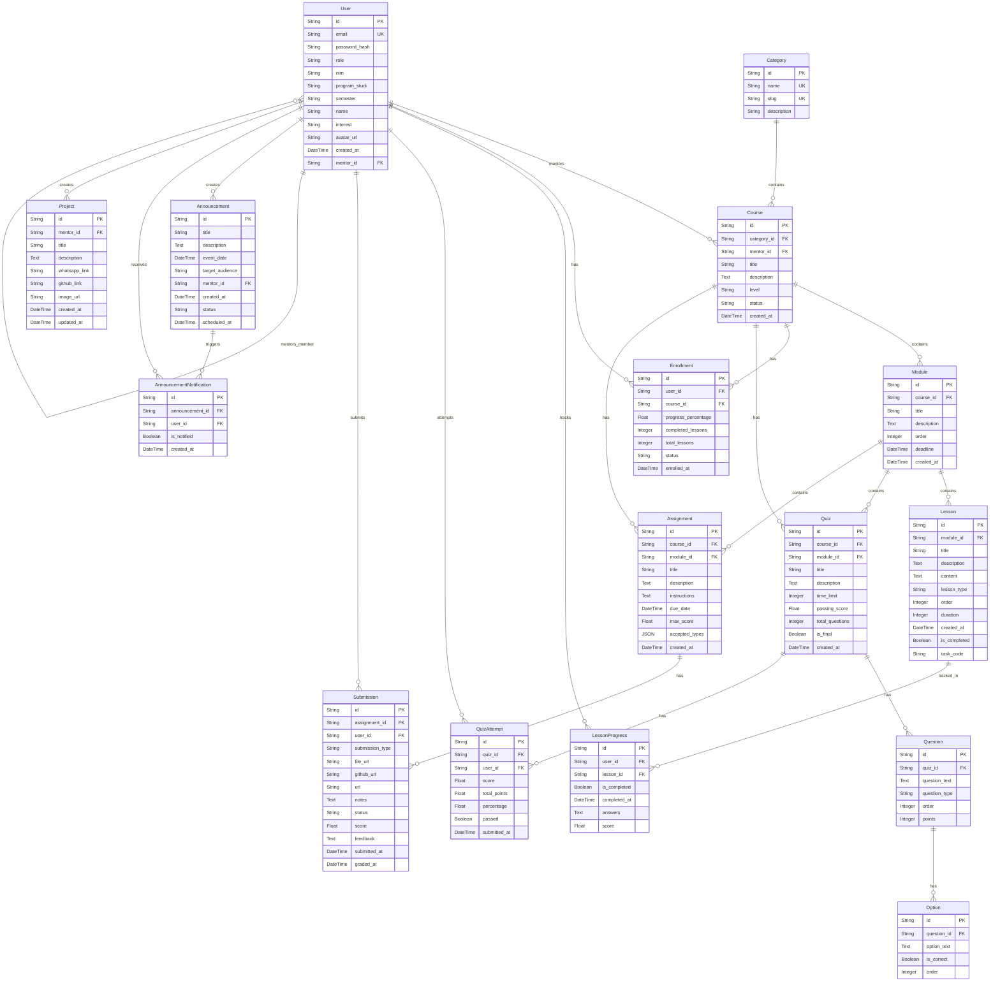

# Database ERD

## ER Diagram

## Entities

- **User**: Represents a user in the system (member, mentor, admin). Contains authentication credentials and profile information, and optional `mentor_id` for mentor assignments.
- **Category**: Represents a classification grouping for courses.
- **Course**: The main entity for a learning subject. Authored by a mentor (User) and belongs to a Category.
- **Module**: A structural grouping unit within a Course. Contains lessons, quizzes, and assignments.
- **Lesson**: A specific teaching material (video, text, task) inside a Module.
- **Enrollment**: Tracks a User's participation in a Course, including their overall completion progress percentage.
- **LessonProgress**: Tracks a specific User's completion status and score for a specific Lesson.
- **Quiz**: A set of questions associated with a Module or Course.
- **Question**: A single question within a Quiz.
- **Option**: A multiple-choice answer option for a Question. Indicates if it is the correct answer.
- **QuizAttempt**: Tracks a User's attempt on a Quiz, containing their total score and pass/fail status.
- **Assignment**: A task given to students that requires manual submission. Belongs to a Module/Course.
- **Submission**: A User's submitted work for an Assignment, graded by a mentor.
- **Announcement**: General or specific announcements created by mentors/admins.
- **AnnouncementNotification**: Tracks whether a user has been notified or read a specific announcement.
- **Project**: Represents a project associated with a mentor's group. Mentors can post links (GitHub, WhatsApp), descriptions, and an image for their group.

## Relationships

- **1:N (User -> Course)**: A User (Mentor) can create many Courses.
- **1:N (Category -> Course)**: A Category can contain many Courses.
- **1:N (Course -> Module)**: A Course contains multiple Modules.
- **1:N (Module -> Lesson)**: A Module contains multiple Lessons.
- **1:N (Course -> Enrollment)**: A Course can have many enrolled Users.
- **1:N (User -> Enrollment)**: A User can enroll in many Courses.
- **1:N (Lesson -> LessonProgress)**: A Lesson has many progress records (one per user).
- **1:N (User -> LessonProgress)**: A User has many lesson progress records.
- **1:N (Course/Module -> Quiz/Assignment)**: Quizzes and Assignments belong to a Module (and Course).
- **1:N (Quiz -> Question)**: A Quiz has many Questions.
- **1:N (Question -> Option)**: A Question has many Options.
- **1:N (Quiz -> QuizAttempt)**: A Quiz can have many attempts.
- **1:N (Assignment -> Submission)**: An Assignment can have many submissions.
- **1:N (User -> Submission/QuizAttempt)**: A User can submit many assignments and attempt many quizzes.
- **1:N (User -> User)**: A User (Mentor) can mentor many other Users.
- **1:N (User -> Announcement)**: A User (Mentor/Admin) can create many announcements.
- **1:N (Announcement -> AnnouncementNotification)**: An announcement triggers many notifications.
- **1:N (User -> AnnouncementNotification)**: A User receives many notifications.
- **1:N (User -> Project)**: A User (Mentor) can create many group projects.

## Design Issues

1. **Redundant Foreign Keys (`course_id` and `module_id` on `Quiz` & `Assignment`)**
   Both `Quiz` and `Assignment` have foreign keys to `course_id` and `module_id`. Since a `Module` inherently belongs to a `Course`, maintaining a direct `course_id` link on the Quiz/Assignment table is technically a redundancy (denormalization). If a module were moved to a different course, the `course_id` on the related quizzes and assignments could become out of sync.
2. **Global state for `Lesson.is_completed`**
   The `Lesson` table contains an `is_completed` boolean field. Since lessons are shared among all enrolled users, this global state is conceptually incorrect (as noted in the model's source code comments). Real progress tracking should strictly rely on the `LessonProgress` table, making `Lesson.is_completed` redundant and a potential source of logic bugs if accidentally used.
3. **No unique constraint on progress/enrollment entities**
   The `Enrollment`, `LessonProgress`, and `QuizAttempt` models use surrogate primary keys (`id`), but there are no explicit unique constraints on their composite foreign keys. For example, a `User` should ideally only have one `Enrollment` per `Course`, or one `LessonProgress` per `Lesson`, but the database schema allows for duplicate rows.
